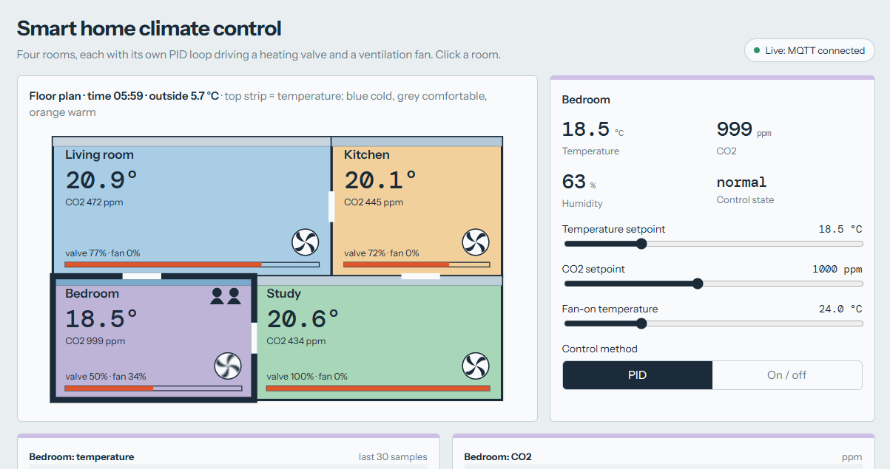
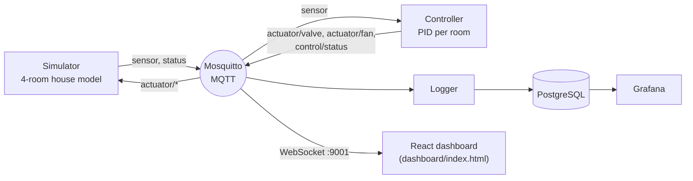
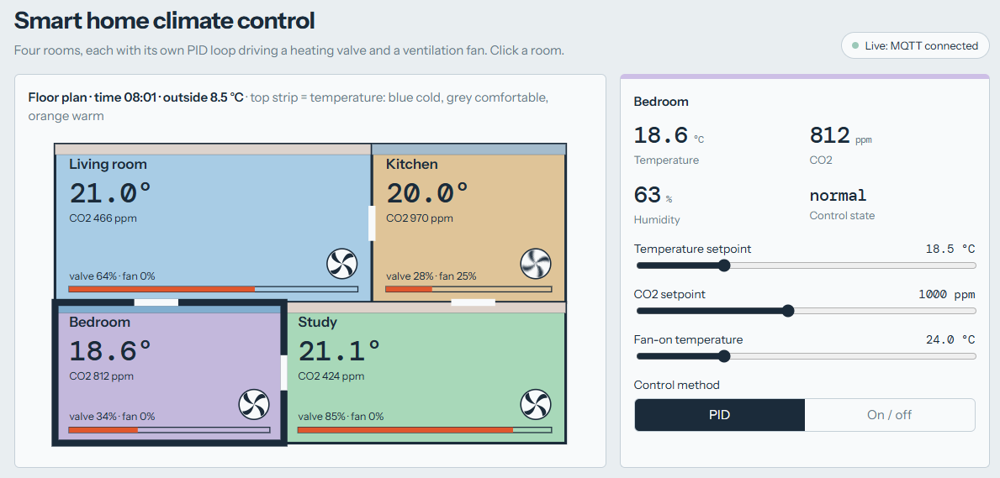
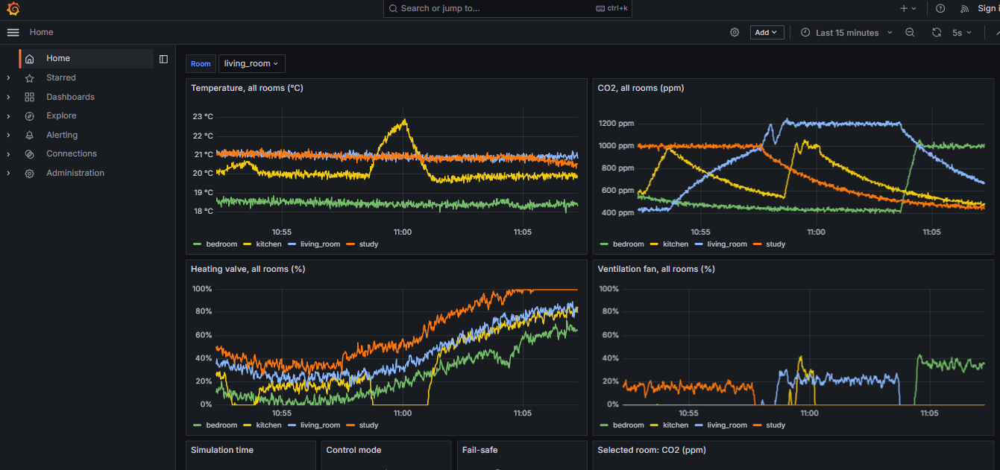

# Smart Home Climate Control

A fully simulated building-automation project: a four-room house whose temperature and CO2 are regulated by
per-room PID loops that drive a heating valve and a ventilation fan. Everything talks over MQTT, is logged to
PostgreSQL, and is visualised in Grafana and in a live React floor-plan dashboard. No hardware required.



## Features

- **Four-room house model** (living room, kitchen, bedroom, study) with per-room volume, wall losses, heater power,
  occupancy schedules, cooking heat, open windows, and heat flow through partition walls.
- **Per-room control**: PI controllers with filtered measurements and anti-windup, switchable at runtime to
  on/off control with hysteresis for comparison.
- **Overheat guard**: when a room reaches 24 °C (configurable per room) the ventilation fan turns on and the heating
  valve closes, so heater and fan do not work against each other (keep the threshold above the setpoint, see notes).
- **Fail-safe**: if a room's sensor data stops, that room alone goes to valve closed / fan 50 %.
- **Live control from the UI or MQTT**: temperature, CO2 and fan-on setpoints plus the control mode, per room.
- **Data pipeline**: a logger buffers rows and survives database outages without losing samples.
- **Reproducible evaluation** scripts that need neither Docker nor MQTT.

## Architecture



| Service | Role |
|---|---|
| `simulator` | Physics of the house (thermal model, CO2 mass balance, humidity); publishes sensors, applies actuator commands |
| `controller` | Discovers rooms from sensor messages, runs the control loops, publishes actuator commands and status |
| `logger` | Subscribes to every room, writes wide rows to the `telemetry` table |
| `postgres`, `grafana` | Storage and dashboards (provisioned automatically) |
| `mosquitto` | MQTT broker with a WebSocket listener for the browser UI |

## Quick start

Requires Docker with Compose.

```bash
docker compose up -d --build
docker compose ps
```

| What | Where |
|---|---|
| Grafana dashboard | http://localhost:3000 (anonymous admin, local development only) |
| React floor-plan dashboard | open `dashboard/index.html` in a browser |
| MQTT broker | `localhost:1883` (WebSocket `9001`) |
| PostgreSQL | `localhost:5433`, database/user/password `climate` |

The simulation runs at 60x (one real second is one simulated minute) and starts at 17:00. Change `SPEED` in the
environment, for example `SPEED=120 docker compose up -d`.

The dashboard connects to Mosquitto over WebSocket. If the broker is not reachable it falls back to an
in-browser simulation (a JavaScript port of the same model and controllers), so it also works as a standalone demo;
`index.html?demo` forces that mode.

### Try it

```bash
# Watch every room's controller state
docker exec -it climate-mosquitto mosquitto_sub -t "building/f1/+/control/status" -v

# Raise the bedroom setpoint, switch the kitchen to on/off control, lower the study's fan threshold
docker exec climate-mosquitto mosquitto_pub -t "building/f1/bedroom/setpoint/temperature" -m "21.5"
docker exec climate-mosquitto mosquitto_pub -t "building/f1/kitchen/control/mode" -m "onoff"
docker exec climate-mosquitto mosquitto_pub -t "building/f1/study/setpoint/fan_on_temp" -m "22.5"

# Query the history
docker exec -it climate-postgres psql -U climate -d climate \
  -c "select room, count(*), round(avg(temperature)::numeric,1) as avg_temp from telemetry group by room;"
```

## MQTT topics

Base topic `building/f1`, rooms `living_room`, `kitchen`, `bedroom`, `study`.

| Topic | Direction | Payload |
|---|---|---|
| `<room>/sensor` | simulator → | `{"temperature", "humidity", "co2", "ts"}` |
| `<room>/status` | simulator → | `{"sim_time", "occupancy", "outdoor_temp", "window_open", "fan", "valve"}` |
| `<room>/actuator/valve`, `<room>/actuator/fan` | controller → simulator | `0-100` |
| `<room>/control/status` | controller → | `{"mode", "sp_temp", "sp_co2", "fan_on_temp", "valve", "fan", "overheat", "failsafe"}` |
| `<room>/setpoint/temperature` | → controller | °C (10-30) |
| `<room>/setpoint/co2` | → controller | ppm (400-2000) |
| `<room>/setpoint/fan_on_temp` | → controller | °C (20-35), default 24 |
| `<room>/control/mode` | → controller | `pid` or `onoff` |

New rooms need no controller change: they are discovered from their first `sensor` message.

## Results

Offline, 24 simulated hours, same scenario and seed for both controllers
(`python tools/compare.py` and `python tools/compare_house.py`).

Single office room:

| Metric | On/off | PID |
|---|---|---|
| Mean temperature error while occupied | 0.26 K | 0.09 K |
| Peak CO2 | 1129 ppm | 1097 ppm |
| Time with CO2 > 1100 ppm (occupied) | 4.1 % | 0 % |
| Mean fan | 19.4 % | 18.8 % |

Four-room house (setpoints 21 / 20 / 18.5 / 21 °C, CO2 setpoint 1000 ppm):

| Room | Temp error on/off → PID | Peak CO2 on/off → PID |
|---|---|---|
| Living room | 0.33 → 0.16 K | 1117 → 1050 ppm |
| Kitchen | 0.95 → 1.06 K | 1112 → 1056 ppm |
| Bedroom | 0.26 → 0.07 K | 1122 → 1062 ppm |
| Study | 0.24 → 0.09 K | 1113 → 1036 ppm |

The kitchen error is not a control problem: cooking adds up to 900 W, the room rises above its setpoint, and a
heating valve cannot cool. Lowering that room's fan-on temperature (for example to 22 °C) makes the fan act as a
range hood.

## Screenshots

Floor-plan dashboard, kitchen ventilating after morning cooking (live MQTT data):



Grafana overview of all four rooms. The kitchen temperature peak is cooking heat; the living-room CO2 plateau at
1200 ppm comes from raising its CO2 setpoint by hand, and the fan stops and restarts accordingly:



## Project structure

```
.
├── docker-compose.yml
├── mosquitto/mosquitto.conf          # MQTT + WebSocket listeners
├── simulator/                        # room_model.py (one room), house_model.py (four rooms), simulator.py (MQTT)
├── controller/                       # control.py (PID, hysteresis, overheat guard), controller.py (MQTT service)
├── logger/                           # MQTT -> PostgreSQL
├── grafana/                          # provisioned datasource and dashboard
├── dashboard/index.html              # React floor-plan UI (single file, no build step)
├── tools/                            # compare.py, compare_house.py (offline evaluation)
└── docs/screenshots/
```

## Configuration

| Variable | Service | Default | Meaning |
|---|---|---|---|
| `SPEED` | simulator, controller | `60` | Simulated seconds per real second (must match) |
| `START_HOUR` | simulator | `17` | Simulated start time |
| `MODE` | controller | `pid` | Initial control mode (`pid` or `onoff`) |
| `SP_CO2` | controller | `1000` | CO2 setpoint (ppm) |
| `FAN_ON_TEMP` | controller | `24` | Fan-on temperature (°C) |
| `SENSOR_TIMEOUT` | controller | `10` | Real seconds without sensor data before fail-safe |

Per-room default temperature setpoints live in `controller/controller.py`; PID gains in `controller/control.py`.

## Notes and limitations

- Plant parameters are plausible estimates, not measured values from a real building.
- PID gains were tuned offline against this simulator with a grid search; they are not auto-tuned.
- The controller's temperature loop only heats; the fan is the only cooling actuator.
- Keep a room's fan-on temperature at least 1-2 °C above its temperature setpoint. If it is set closer (or below), the
  heater pushes the room over the threshold, the guard turns the fan on and closes the valve, the room cools, the guard
  releases, and valve and fan alternate on and off.
- Credentials in `docker-compose.yml` and anonymous Grafana admin access are for local development only.

## License

MIT, see [LICENSE](LICENSE).